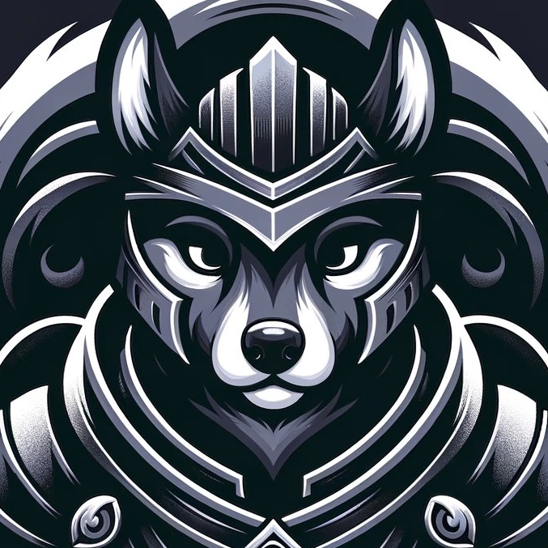
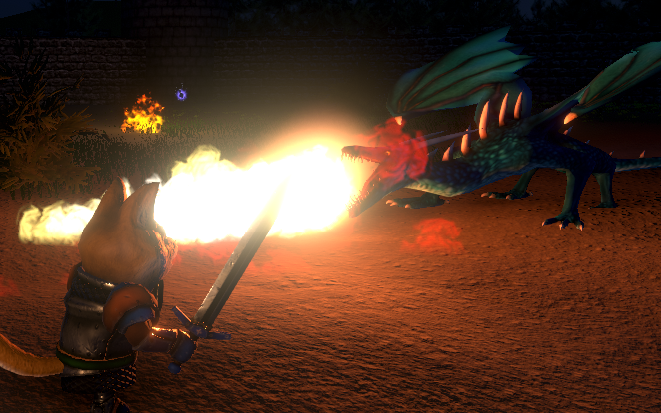

  
  <h1>Doggy Man 3D</h1>
  
  
  
  
A third-person RPG created by the SEMPA team as a university project.

## About

After a dragon destroys his home, Doggy Man sets out for revenge. Fight through
six levels, manage your health and stamina, collect items, and face the dragon.
The game includes intro and outro cinematics, enemies, traps, gates and a
four-slot inventory.

See the [game guide](./doc/GAMEPLAY.md) for details on menus, levels, items,
enemies, gates and screenshots.

### Videos

- [Teaser trailer](https://youtu.be/iurHWjnuU00)
- [Full game walkthrough](https://youtu.be/VHRkJi0dqkY)

## Download and play

Download a build for Windows, macOS, Linux or Android from the
[latest release](https://github.com/0xMartin/DoggyMan3D/releases/latest), where
available. Older releases may contain source code only.

- **Linux:** The provided build uses Vulkan; it was tested on Pop!_OS.
- **Android:** Tested on Android 13.
- **Windows build on Linux:** Alternatively, run `wine DoggyMan3D.exe` with Wine.

## Controls

| Action | Keyboard and mouse |
| --- | --- |
| Move | WASD or arrow keys |
| Look | Mouse |
| Sprint | Left Shift |
| Attack | Left mouse button |
| Use inventory item | 1-4 |
| Pause | Escape |

The Android version uses on-screen controls.
After exhausting stamina, release sprint and press it again once stamina has
recovered.

On desktop, adjust mouse-look sensitivity under **Settings** in the main menu
and select **Apply** to save and return to the menu. The setting is saved
between sessions.

## Open the Unity project

1. Install **Unity 6000.3.8f1** through Unity Hub, including the build support
   module for each target platform you intend to build.
2. Clone or download this repository.
3. In Unity Hub, add the [`DoggyMan3D`](./DoggyMan3D) folder as an existing
   project and open it with that editor version.
4. Open [`MainMenu.unity`](./DoggyMan3D/Assets/Scenes/Menu/MainMenu.unity) and
   enter Play mode.

The first import can take some time. Keep Unity `.meta` files with their assets
when moving or renaming them so scene and prefab references remain intact.

## Build from source

In Unity, open **File > Build Profiles**, choose the target platform and switch
to it if necessary, then build. The enabled scenes and their order are recorded
in [`EditorBuildSettings.asset`](./DoggyMan3D/ProjectSettings/EditorBuildSettings.asset).
Android builds also require the Android build support module and its SDK/NDK
and JDK dependencies.

## Saved games

Start a new game from the main menu or choose an existing save under **Load
Game**. Progress is saved when a game is created and when advancing to the next
level.
Saves are stored under Unity's `Application.persistentDataPath`, which varies
by platform. Existing saves remain usable; separate games can use the same
player name. The inventory is cleared when starting or restarting a level.

## License and assets

Original game source code and Unity project configuration authored by the
copyright holders are licensed under the [MIT License](./LICENSE). This does
not cover game assets such as models, artwork, scenes, prefabs, animations,
audio and other audiovisual content, or third-party code and packages.

The project includes both team-created and third-party assets, including assets
from the Unity Asset Store and sound effects from Freesound. Their respective
licenses and permissions must be checked before using or redistributing them;
their presence in this repository does not grant rights to them.

## Authors

Created by the SEMPA team:
[0xMartin](https://github.com/0xMartin),
[eobadalova](https://github.com/eobadalova), and
[PaulieBossCZ](https://github.com/PaulieBossCZ).
