# Doggy Man 3D: Game Guide

[Back to the README](../README.md)

- [Doggy Man 3D: Game Guide](#doggy-man-3d-game-guide)
  - [Menus](#menus)
  - [Gameplay](#gameplay)
      - [Desktop Controls](#desktop-controls)
      - [Android Controls](#android-controls)
    - [Android](#android)
  - [Levels](#levels)
  - [Items](#items)
  - [Enemies and traps](#enemies-and-traps)
    - [Ghost](#ghost)
    - [Spider](#spider)
    - [Skeleton](#skeleton)
    - [Slender](#slender)
    - [Dragon](#dragon)
    - [Traps](#traps)
  - [Gates and levers](#gates-and-levers)

## Menus

The main menu lets you start a new game, load a previous save and adjust the
resolution.

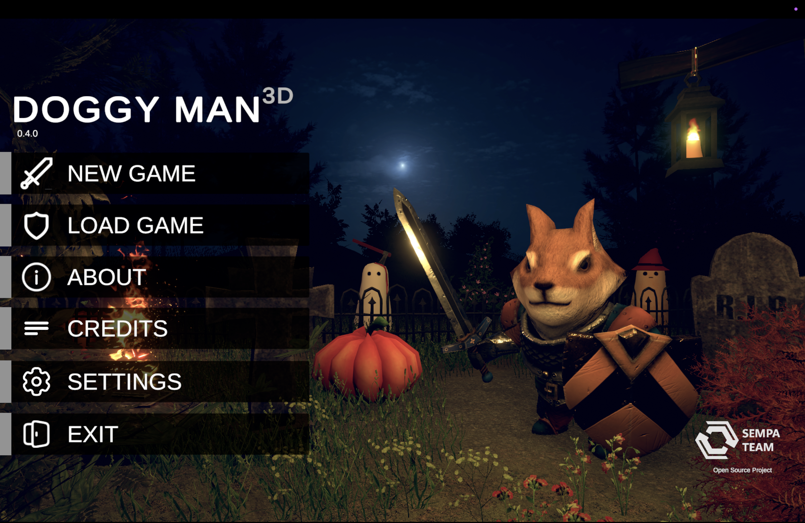

The in-game menu lets you resume, restart the current level or return to the
main menu.

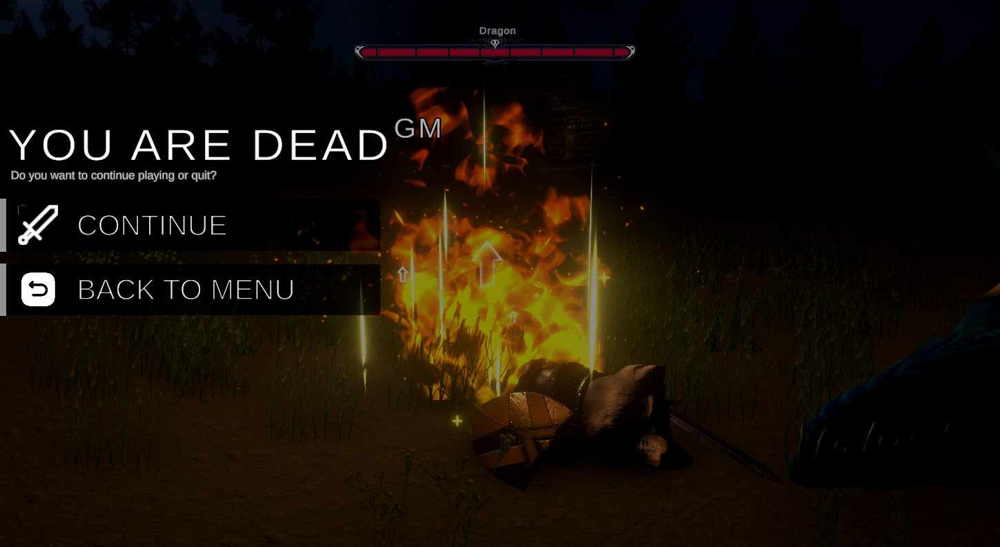

## Gameplay

Control Doggy Man from a third-person perspective. If he loses all his lives,
you must restart the current level.

Walking and sprinting help you explore, but sprinting consumes stamina. When
stamina runs out, you must wait for it to recover before sprinting again. Low
stamina also makes attacks less effective.

The interface shows health (red bar), stamina (green bar) and inventory. You can carry up to four
items at a time. When the inventory is full, use an item to make space for new ones.

#### Desktop Controls

| Action | Keyboard and mouse |
| --- | --- |
| Move | WASD or arrow keys |
| Look | Mouse |
| Sprint | Left Shift |
| Attack | Left mouse button |
| Use inventory item | 1-4 |
| Pause | Escape |

#### Android Controls

On Android, use the on-screen controls to move, look around, attack, use inventory items, and pause the game.

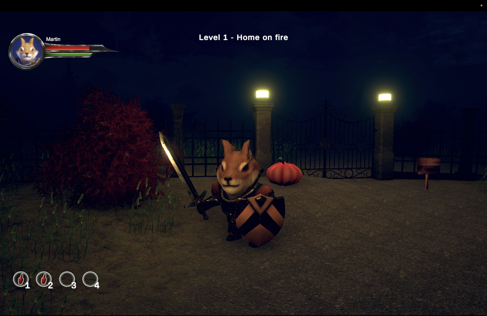
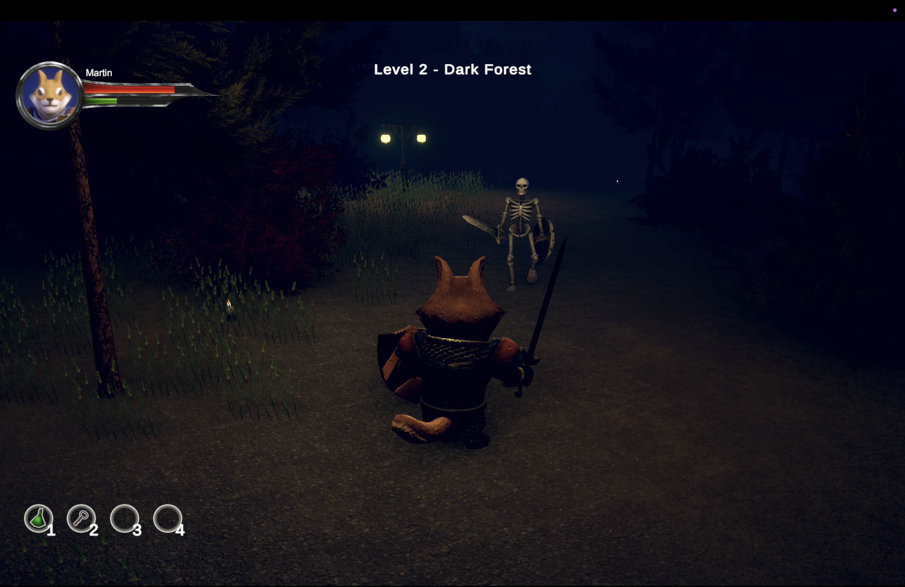

### Android

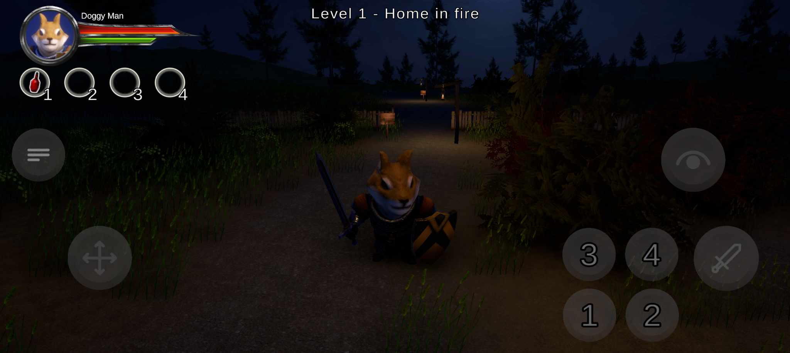

## Levels

The game has six increasingly challenging levels, along with intro and outro
cinematics. Explore each environment, overcome enemies and obstacles, and make
your way to the dragon's lair.

  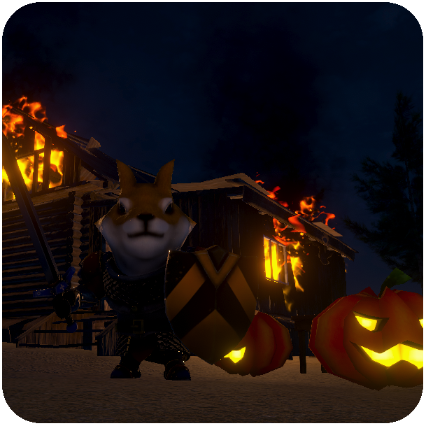
  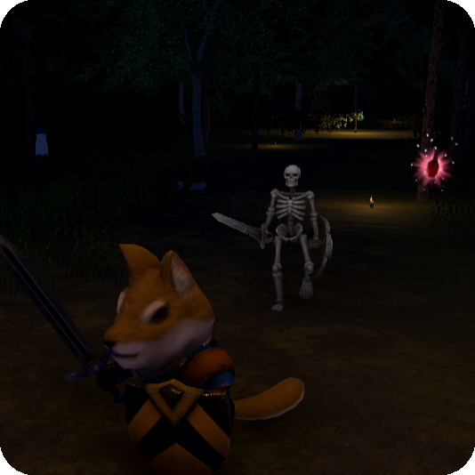
  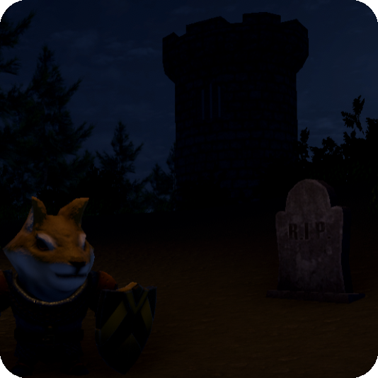

  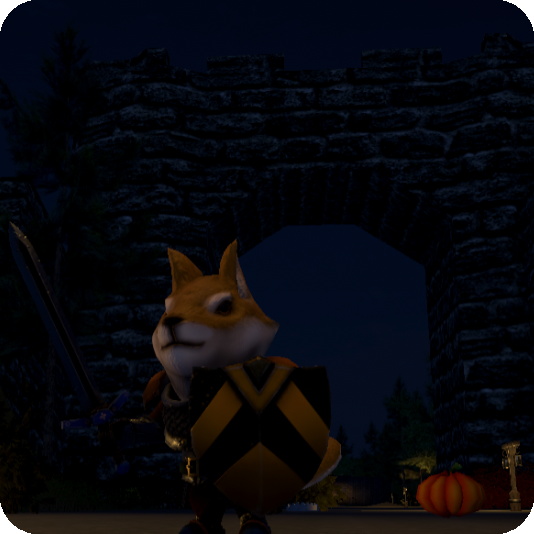
  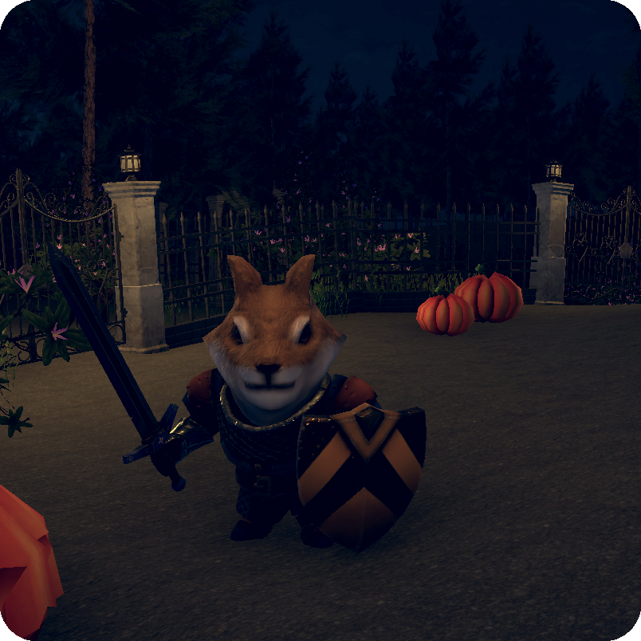
  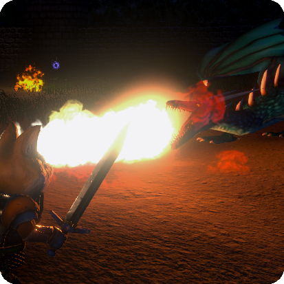

## Items

- **Health potion (red):** Restores health.
- **Stamina potion (green):** Temporarily allows sprinting without consuming
  stamina.
- **Strength potion (blue):** Temporarily increases attack damage.
- **Key:** Unlocks matching gates and doors.

## Enemies and traps

### Ghost

Ghosts are common enemies. Individually weak, they can be dangerous in groups.

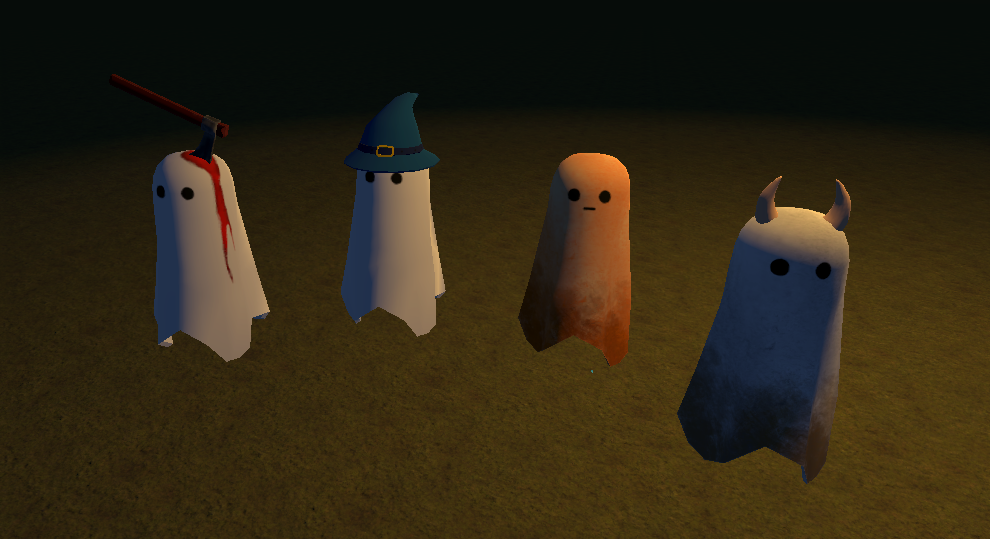

### Spider

Spiders are larger and more resilient than ghosts.

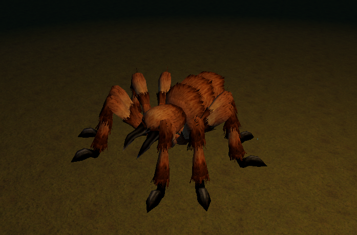

### Skeleton

Skeletons are strong enemies capable of inflicting heavy damage.

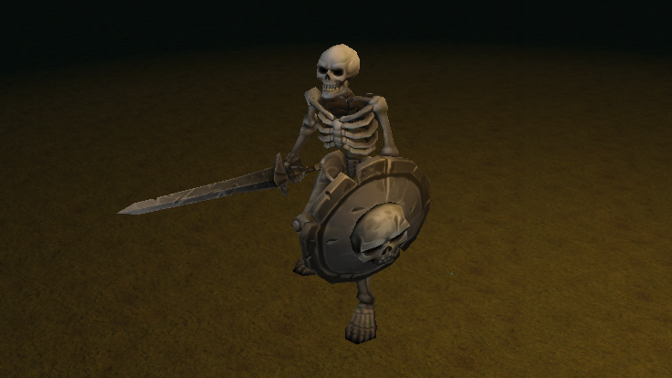

### Slender

Slender moves between marked points and cannot be killed. Getting too close is
instantly fatal.

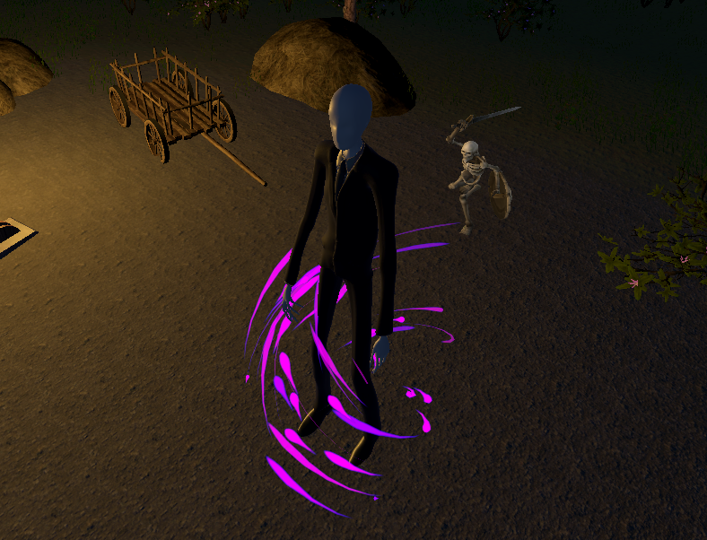

### Dragon

The dragon is the final boss, using fire and physical attacks.

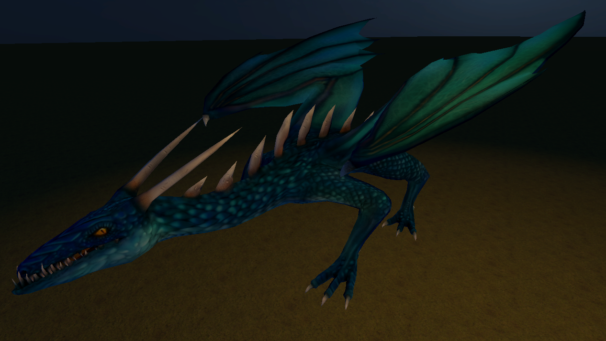

### Traps

Watch out for hazards such as spikes and hidden pitfalls.

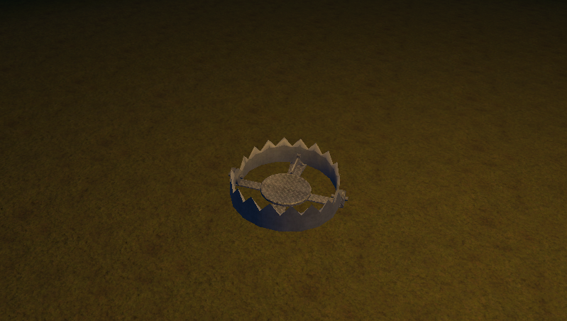

## Gates and levers

Gates block the way forward. Depending on the gate, you may need to find a key,
defeat enemies or activate a lever.

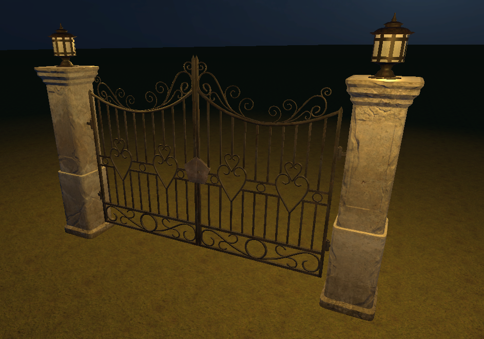

Strike a lever with your sword to activate it and open its associated gate.

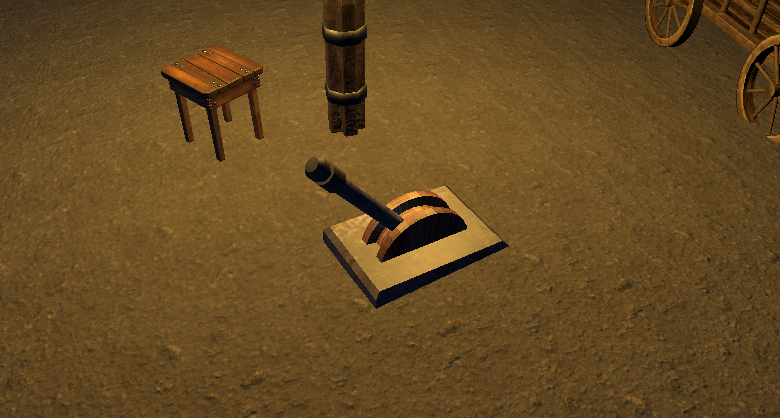
